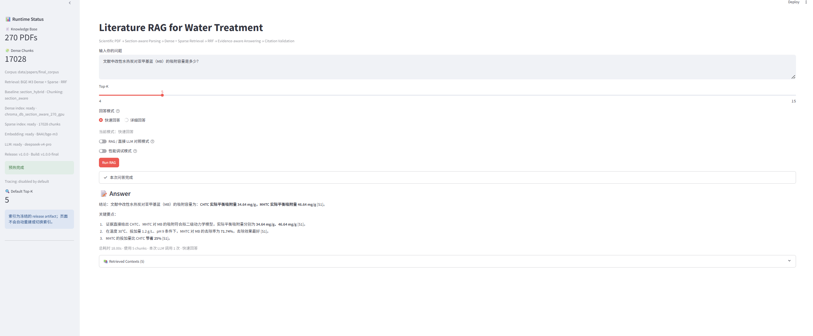
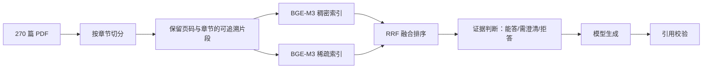
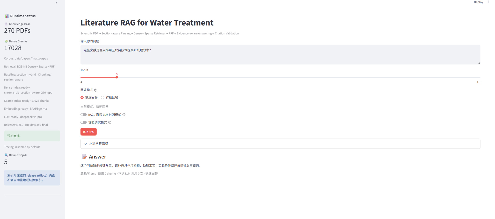

# 水处理文献问答系统

一个面向水处理科研论文的检索问答系统。语料是 270 篇真实 PDF，用户用中文或英文提问，系统检索相关段落、给出带出处的回答；如果检索不到足够证据，它会说"答不了"而不是编。

这是我做硕士课题时顺手攒下来的东西。文献里查数据太慢，一个吸附容量往往埋在几十篇论文的表格和正文里，所以想试试能不能自动化这个过程。做下来发现难点根本不在生成，而在"怎么判断检索到的段落真的能支撑这个结论"。



## 检索链路



切分是按章节做的，不是按固定字符数硬切。科研论文的段落有语义边界，方法节和结论节的同一句话含义完全不同，硬切会把表格和正文混在一起。每个片段都保留论文 ID、页码、章节名，回答里的引用能一路点回到原文位置。

稠密和稀疏两路检索结果用 RRF 融合。稀疏检索对专业术语和数字（比如"34.64 mg/g"）更敏感，稠密检索对同义改写更宽容，两路互补。

参考文献列表被主动排除在索引之外。之前不做这个处理时，检索会命中某篇综述的参考文献条目，看起来像找到了证据，其实只是一条书目信息。

## 评测

用一套和开发集完全无重叠的 32 条验收题，所有题目重新定位到本地 PDF 做过人工核对，定位错误 0 条。

| 指标 | 结果 |
|---|---:|
| Recall@10 | 91.3% |
| PageHit@10 | 91.3% |
| EvidenceSpanHit@10 | 87.0% |
| 动作判断准确率 | 75.0% |
| 应答题准确率 | 71.4% |
| 无证据题识别率 | 100% |

动作判断指系统对每条问题的处理是否恰当：该答的答了、该澄清的澄清了、该拒的拒了、前提错误的纠正了。75% 不算高，主要失误集中在"应该澄清却直接回答"这一类。

检索召回 91.3%，剩下 8.7% 的漏检原因我逐条查过：一部分是 gold 段落落在参考文献里（这类无解，除非把参考文献加回索引），一部分是中文查询把中文硕论排在英文目标论文前面，还有一部分是融合排序把正确答案挤出了前十。

方法和冻结输入的哈希值写在 [docs/evaluation.md](docs/evaluation.md)。

## 拒答与引用校验

这两块是系统可信度的关键，也是我花时间最多的地方。

拒答分四种动作：直接回答、要求澄清、拒答、指出问题前提有误。比如问"某材料的吸附容量是多少"但没说 pH 和温度，系统会先问条件；问"为什么 A 材料比 B 材料好"而检索到的证据互相矛盾时，它会分来源呈现结果，而不去编一个统一结论。



引用校验是生成之后做的：回答里的每个引用标记必须能映射回本次检索到的片段，映射不上的标记会被剔除或标记为无支撑。这一步不依赖模型自我声明，是确定性检查。

自动校验给出的引用支持率是 61.9%，无支撑论断比例 42.86%。后面这个数字**不是幻觉率**，校验器有意保守，还会受生成长度截断和书目类论断识别的影响。人工抽查了 11 条证据，10 条支持、1 条被标记，唯一那条是 `34.64 mg/g` 和 `34.64mg/g` 的空格归一化问题。所以准确的说法是：在能自动验证的范围内，引用基本可靠；超出这个范围的部分，系统不做承诺。

## 一次失败的尝试

早期版本里我加了一个基于关键词的冲突检测：检索结果里同时出现 "increase" 和 "decrease" 就判定证据冲突，转成"来源有分歧"的回答。在开发集上效果不错。

换到独立评测集上直接崩了。普通可回答的段落里同时出现这两个词太常见了，比如"温度升高时吸附量增加，但超过 40 度后下降"，这明明是同一篇论文在描述完整规律，被误判成两篇文献结论冲突。

消融实验的结果是关掉这个规则 6 胜 1 负。所以我把它删了，而不是继续加规则去补。这个教训我记下了：在评测集上调规则，很容易把过拟合当成进步。

## 快速开始

需要 Python 3.11 以上、本地 PDF 语料和 BGE-M3 模型。索引不随仓库发布，需要自己构建。

```powershell
Copy-Item .env.example .env
```

在 `.env` 里配好模型接口和语料路径。仓库里的示例配置指向冻结版本的结构：

```env
PDF_DIR=./data/papers/final_corpus
CHROMA_DIR=./chroma_db_section_aware_270_gpu
COLLECTION_NAME=section_aware_270_gpu
CHUNKING_MODE=section_aware
RETRIEVAL_MODE=hybrid_dense_sparse
SPARSE_INDEX_DIR=./sparse_index_section_aware_270_gpu
```

分别启动 API 和界面：

```powershell
.\.venv\Scripts\python.exe -m uvicorn api_server:app --host 127.0.0.1 --port 8010
.\.venv\Scripts\python.exe -m streamlit run app.py --server.address 127.0.0.1 --server.port 8501
```

健康检查会返回当前版本、检索模式、文档数、索引片段数和稀疏索引状态：

```powershell
Invoke-RestMethod http://127.0.0.1:8010/health
```

Windows 上可以用桌面启动器，它会拉起同样的 API 和界面进程，等服务预热完再打开浏览器，不会重建索引：

```powershell
.\deploy\windows\build_launcher.cmd
powershell -ExecutionPolicy Bypass -File .\deploy\windows\create_desktop_shortcut.ps1
```

## 项目结构

```text
api_server.py       FastAPI 服务
app.py              Streamlit 界面
app_eval.py         评测界面
src/                检索、切分、生成、引用校验、评测、链路追踪
src/eval/           评测框架：运行、打分、导出、坏例分析
scripts/            语料抓取、索引构建、消融实验、验收脚本
tests/              单元测试与回归测试
docs/               评测方法、实验记录、Prompt 与检索调优、语料清单、测试题库
deploy/windows/     Windows 桌面启动器和打包脚本
groundtruth/        评测集模板（真实评测数据不入库）
```

## 局限

- 语料只有 270 篇正文 PDF，不含补充材料
- 不解析补充材料里的 XLSX/CSV 数据集
- PDF 表格提取会丢行列结构，纯图表的证据不在覆盖范围内
- 参考文献被排除在索引外，代价是书目类问题答不了
- 不做自动的冲突分类，条件差异交给回答层按来源分别呈现
- 中文查询检索英文论文的效果明显弱于英文查询

完整说明见 [LIMITATIONS.md](LIMITATIONS.md)。

## 测试

```powershell
.\.venv\Scripts\python.exe -m pytest
```

本地最终一轮 189 个测试全部通过。验收数据、语料和索引产物按设计不进 Git。

## 数据与许可

代码用 MIT 许可。仓库不发布论文原文、向量索引、评测 gold 数据和 API 凭据。语料中的论文版权归原作者与出版方所有，超出本项目范围使用前请自行确认许可条件。
